# Arquitectura de PIA-3

## Arquitectura actual en `e39eb37`

El [Dockerfile](../Dockerfile) instala el proyecto con pip sobre Python 3.12 y ejecuta `python -m sistema.security_integrated`. El [entrypoint](../src/sistema/security_integrated.py) abre SQLite, carga Whisper, inicia el worker de notas, conecta MQTT y activa un hilo de heartbeat. Con `PIA3_ENABLE_OUTBOX=1`, valor del [Compose](../docker-compose.yml), inicia también el worker de publicaciones. La imagen usa `0` como valor por defecto.

```mermaid
flowchart LR
    N["MQTT · planta/recorridas"] --> R["Validación NotaRecorrida"]
    R --> DB["SQLite · notas"]
    DB --> W["Worker persistente"]
    W --> H["HTTP · descarga del WAV"]
    H --> V["Validación WAV"]
    V --> S["STT local · Whisper base"]
    S --> D["Detector S1–S4"]
    D --> T["Transacción · completa nota y encola mensajes"]
    T --> O["SQLite · outbox"]
    O --> P["Worker outbox · MQTT QoS 1"]
    P --> M["sistema/eventos y sistema/tablet"]
```

### Entrada, procesamiento y contrato

1. [MQTT](../src/sistema/mqtt_client.py) se suscribe a `planta/recorridas` al conectarse. El [router](../src/sistema/nota_router.py) valida el JSON con `NotaRecorrida` y requiere `audio_url`. La [entrada persistente](../src/sistema/persistent_ingress.py) guarda el payload en SQLite. El [almacén](../src/sistema/note_store.py) deduplica por ID de nota.
2. El [worker de notas](../src/sistema/persistent_worker.py) reclama una nota elegible. El [procesador](../src/sistema/security_persistent_processor.py) llama al [pipeline](../src/sistema/security_pipeline.py). El [cliente de audio](../src/sistema/audio_service.py) consulta la ruta bajo `/media/audios/` en la API de planta, limita la lectura a 20 MiB y verifica la cabecera RIFF. El [servicio de transcripción](../src/sistema/transcription_service.py) exige WAV mono, 16 kHz y 16 bits y rechaza transcripciones vacías. El [adaptador Whisper](../src/sistema/whisper_adapter.py) ejecuta `base` en CPU, INT8, con cuatro hilos solicitados y transcripción en español.
3. El [detector](../src/sistema/security_detector.py) normaliza y segmenta el texto, aplica patrones y trata negaciones. Detecta S1 (proyección de agua a presión), S2 (olor a gas), S3 (humo o fuego) y S4 (persona lesionada). La decisión se toma con reglas locales. El código de referencia recorre coincidencias posteriores y contempla negaciones coordinadas.
4. Los [mensajes de seguridad](../src/sistema/security_messages.py) generan un `EventoSistema` de tipo `AlertaSeguridad` por condición y un `MensajeTablet` por nota con hallazgos. El aviso pide aplicar el procedimiento de emergencia y avisar por radio al supervisor, con `espera_respuesta=False`. Conservan el timestamp y la referencia de la nota y usan IDs deterministas.

El paquete oficial `planta_contrato` se instala con pip desde la referencia de [pyproject.toml](../pyproject.toml). Los modelos Pydantic oficiales validan la nota entrante y construyen los eventos, avisos y latidos. Los tópicos se toman de `Topicos`.

### Persistencia, recuperación y publicaciones

El Compose monta `pia3_datos` sobre `/app/data_runtime`. Las notas y la [outbox](../src/sistema/security_outbox.py) comparten `seguridad.sqlite3`. La [transacción](../src/sistema/security_transaction.py) completa la nota e inserta los mensajes juntos. Ante un fallo se revierte la operación. Una nota sin condiciones de seguridad se completa sin generar mensajes.

Al iniciar, ambos workers recuperan filas con operaciones interrumpidas. Las notas y las publicaciones usan reintentos programados con un tope de tres intentos. La outbox expone una operación de reactivación de envíos agotados. El [worker de outbox](../src/sistema/outbox_worker.py) llama al [publicador](../src/sistema/outbox_publisher.py), que espera el acuse MQTT de QoS 1 antes de confirmar el envío en SQLite. Si falla la confirmación local después del acuse, puede haber un reenvío con el mismo ID. La suscripción de entrada usa QoS 0 por defecto.

El heartbeat corre en un hilo del entrypoint separado de los workers. Cuando MQTT está conectado publica `EstadoSistema` en `sistema/estado` con QoS 1 cada 30 s. `enlace_ok` y `pendientes_sincronizar` usan los valores provisionales `True` y `0`. La primera publicación depende de que termine la carga inicial de Whisper y se conecte MQTT.

### Red y recursos

`agente-planta` está solo en la red externa `planta-lan` y lleva la etiqueta `academia.planta: pc`. Usa `broker:1883` y `http://sim:8100` en esa red. El acceso externo usa `HTTP_PROXY` y `HTTPS_PROXY` en `http://enlace:3128`, con `NO_PROXY=broker,sim,localhost,127.0.0.1`. `pia3_modelos` conserva la caché de Whisper en `/app/modelos`. El agente tiene 2 CPU y 2 GiB de memoria en Compose.

[main.py](../src/sistema/main.py), [security_runtime.py](../src/sistema/security_runtime.py), [security_worker.py](../src/sistema/security_worker.py), [security_processor.py](../src/sistema/security_processor.py), [security_publisher.py](../src/sistema/security_publisher.py) y los scripts de humo son puntos de entrada o rutas alternativas. El servicio de Compose usa el circuito persistente descrito arriba. La evidencia de auditoría y sus límites se registran en el [plan](PLAN.md).

## Arquitectura propuesta para completar Entrega 1

- **Parte de voz y tablet.** Agregar extracción validada a `FilaParte` a partir de la transcripción y de los datos de planta e historian. Descargar y asociar las fotos. Publicar el borrador en la tablet, procesar `planta/respuestas` y conservar la confirmación. Integrar este flujo sin demorar la alerta local.
- **Detección y clasificación B1 · obligatorias en Entrega 1.** Procesar partes confirmados y desvíos de `planta/sensores/#`. Aplicar límites oficiales con reglas deterministas en código y emitir `SinNovedad` o `Escalado` con evidencia. Derivar del estado efectivo del sistema los campos de enlace y pendientes del latido.
- **PostgreSQL 16 y pgvector.** Incorporar PostgreSQL a Compose para persistir la conversación del parte y alojar el índice documental. Conservar temporalmente SQLite para notas y outbox de seguridad mientras se valida cualquier cambio de persistencia de ese circuito.
- **Tools y MCP.** Incorporar herramientas de solo lectura con esquemas Pydantic estrictos sobre fuentes oficiales. Exponer al menos una por MCP y reutilizar su contrato de consulta.
- **RAG y armado de contexto.** Indexar el corpus con metadatos y vigencia. Recuperar y citar secciones aplicables. El contexto combinará documentación con datos operativos de API o SQL para límites y stock.

El análisis completo de las causas de un escalado y la generación de órdenes de trabajo corresponden a entregas posteriores.

Estos circuitos propuestos están pendientes en la implementación inspeccionada. El alcance y la secuencia se mantienen en [PLAN.md](PLAN.md).
