# Arquitectura de PIA-3

## Circuito persistente de seguridad

El [Dockerfile](../Dockerfile) instala el proyecto con pip sobre Python 3.12 y ejecuta `python -m sistema.security_integrated`. El [entrypoint](../src/sistema/security_integrated.py) abre SQLite, carga Whisper, inicia el worker de notas, conecta MQTT y activa un hilo de heartbeat. Con `PIA3_ENABLE_OUTBOX=1`, valor del [Compose](../docker-compose.yml), inicia también el worker de publicaciones. La imagen usa `0` como valor por defecto.

```mermaid
flowchart LR
    N["MQTT · planta/recorridas"] --> R["Validación NotaRecorrida"]
    R --> DB["SQLite · notas"]
    DB --> W["Worker persistente"]
    W --> H["HTTP · descarga del WAV"]
    H --> V["Validación WAV"]
    V --> S["STT local · Whisper base"]
    S --> D["Detector S1–S4"]
    D --> T["Transacción · completa nota y encola mensajes"]
    T --> O["SQLite · outbox"]
    O --> P["Worker outbox · MQTT QoS 1"]
    P --> M["sistema/eventos y sistema/tablet"]
```

### Entrada, procesamiento y contrato

1. [MQTT](../src/sistema/mqtt_client.py) se suscribe a `planta/recorridas` al conectarse. El [router](../src/sistema/nota_router.py) valida el JSON con `NotaRecorrida` y requiere `audio_url`. La [entrada persistente](../src/sistema/persistent_ingress.py) guarda el payload en SQLite. El [almacén](../src/sistema/note_store.py) deduplica por ID de nota.
2. El [worker de notas](../src/sistema/persistent_worker.py) reclama una nota elegible. El [procesador](../src/sistema/security_persistent_processor.py) llama al [pipeline](../src/sistema/security_pipeline.py). El [cliente de audio](../src/sistema/audio_service.py) consulta la ruta bajo `/media/audios/` en la API de planta, limita la lectura a 20 MiB y verifica la cabecera RIFF. El [servicio de transcripción](../src/sistema/transcription_service.py) exige WAV mono, 16 kHz y 16 bits y rechaza transcripciones vacías. El [adaptador Whisper](../src/sistema/whisper_adapter.py) ejecuta `base` en CPU, INT8, con cuatro hilos solicitados y transcripción en español.
3. El [detector](../src/sistema/security_detector.py) normaliza y segmenta el texto, aplica patrones y trata negaciones. Detecta S1 (proyección de agua a presión), S2 (olor a gas), S3 (humo o fuego) y S4 (persona lesionada). La decisión se toma con reglas locales. El código de referencia recorre coincidencias posteriores y contempla negaciones coordinadas.
4. Los [mensajes de seguridad](../src/sistema/security_messages.py) generan un `EventoSistema` de tipo `AlertaSeguridad` por condición y un `MensajeTablet` por nota con hallazgos. El aviso pide aplicar el procedimiento de emergencia y avisar por radio al supervisor, con `espera_respuesta=False`. Conservan el timestamp y la referencia de la nota y usan IDs deterministas.

El paquete oficial `planta_contrato` se instala con pip desde la referencia de [pyproject.toml](../pyproject.toml). Los modelos Pydantic oficiales validan la nota entrante y construyen los eventos, avisos y latidos. Los tópicos se toman de `Topicos`.

### Persistencia, recuperación y publicaciones

El Compose monta `pia3_datos` sobre `/app/data_runtime`. Las notas y la [outbox](../src/sistema/security_outbox.py) comparten `seguridad.sqlite3`. La [transacción](../src/sistema/security_transaction.py) completa la nota e inserta los mensajes juntos. Ante un fallo se revierte la operación. Una nota sin condiciones de seguridad se completa sin generar mensajes.

Al iniciar, ambos workers recuperan filas con operaciones interrumpidas. Las notas y las publicaciones usan reintentos programados con un tope de tres intentos. La outbox expone una operación de reactivación de envíos agotados. El [worker de outbox](../src/sistema/outbox_worker.py) llama al [publicador](../src/sistema/outbox_publisher.py), que espera el acuse MQTT de QoS 1 antes de confirmar el envío en SQLite. Si falla la confirmación local después del acuse, puede haber un reenvío con el mismo ID. La suscripción de entrada usa QoS 0 por defecto.

El heartbeat corre en un hilo del entrypoint separado de los workers. Cuando MQTT está conectado publica `EstadoSistema` en `sistema/estado` con QoS 1 cada 30 s. `enlace_ok` y `pendientes_sincronizar` usan los valores provisionales `True` y `0`. La primera publicación depende de que termine la carga inicial de Whisper y se conecte MQTT.

### Red y recursos

`agente-planta` está solo en la red externa `planta-lan` y lleva la etiqueta `academia.planta: pc`. Usa `broker:1883` y `http://sim:8100` en esa red. El acceso externo usa `HTTP_PROXY` y `HTTPS_PROXY` en `http://enlace:3128`, con `NO_PROXY=broker,sim,localhost,127.0.0.1`. `pia3_modelos` conserva la caché de Whisper en `/app/modelos`. El agente tiene 2 CPU y 2 GiB de memoria en Compose.

[main.py](../src/sistema/main.py), [security_runtime.py](../src/sistema/security_runtime.py), [security_worker.py](../src/sistema/security_worker.py), [security_processor.py](../src/sistema/security_processor.py), [security_publisher.py](../src/sistema/security_publisher.py) y los scripts de humo son puntos de entrada o rutas alternativas. El servicio de Compose usa el circuito persistente descrito arriba. La evidencia de auditoría y sus límites se registran en el [plan](PLAN.md).

## B1 en el Issue #13

El entrypoint de Compose suscribe lecturas de sensores y energía y entrega las tramas a un worker separado. Los partes confirmados generan un trabajo en la misma transacción que guarda la respuesta definitiva. Sensores y partes producen decisiones persistidas por equipo. El worker de eventos valida `EventoSistema` y guarda el payload y su evidencia mínima en una transacción SQLite. Los carriles de seguridad, tablet y B1 tienen publicadores independientes que confirman QoS 1 tras el ACK de MQTT. El enriquecimiento añade tendencias y fotos fuera de esa transacción. [Diseño B1](SPEC_CLASIFICACION_B1.md)

La corrida oficial obtuvo 75,0/100 y B1 5,83/10 en los dos escenarios obligatorios. Conservó B2, F1, F2 y las eliminatorias y registró dos bloqueos de SQLite en el procesamiento de sensores y el encolado B1. El ensayo con broker real y fuentes de planta controladas corroboró recuperación de episodios, evidencia y envío pendiente. La cobertura de alertas por voz bajo saturación sigue abierta. [Evaluación B1](EVALUACION_B1.md)

## PostgreSQL en el Issue #15

El arranque estándar de Compose incluye PostgreSQL 16 con pgvector 0.8.7, en `planta-lan` y con la etiqueta `academia.planta: pc`. El servicio usa `postgres:5432` dentro de la red de planta y tiene el volumen `pia3_postgres` en `/var/lib/postgresql/data`. Su límite de 1 CPU y 1 GiB deja el total de la solución en 3 CPU y 3 GiB, dentro del máximo de 4 CPU y 8 GB. [Compose](../docker-compose.yml)

El rol de administración crea la extensión `vector` y un rol de aplicación con permiso de conexión a `pia3` y acceso a la extensión. La inicialización 001 se ejecuta en un volumen nuevo y admite reaplicación como administrador. El healthcheck comprueba autenticación por TCP y presencia de la extensión. El cliente psycopg lee la configuración cuando un consumidor abre una conexión. El agente carece de una dependencia de arranque con PostgreSQL y la base valida sus credenciales en su propio entrypoint. [Inicialización 001](../infra/postgres/001-vector.sql) · [Cliente psycopg](../src/sistema/postgres.py)

SQLite sigue siendo la fuente de notas, partes, episodios, evidencia y outbox. PostgreSQL separa la vista conversacional por nota en `memoria.partes` de la ingesta documental en el esquema `rag`. [Decisión DT-03](DECISIONES_TECNICAS.md#dt-03--conservar-sqlite-e-integrar-postgresql-16-con-pgvector)

## Memoria conversacional en el Issue #17

SQLite registra una revisión pendiente en la misma transacción que cambia la nota, el parte o una respuesta. Un hilo independiente extrae una captura consistente, cierra la lectura SQLite y escribe en PostgreSQL. El reconocimiento local sigue al commit remoto y las revisiones menores o repetidas se descartan en PostgreSQL. La consulta por ID devuelve el documento remoto y el estado de sincronización respecto de SQLite. [Mini spec y política de memoria](SPEC_MEMORIA_CONVERSACIONAL.md)

## Tools de consulta en el Issue #19

El registro valida los argumentos antes de llamar a los handlers y publica JSON Schema de entrada y salida. Cada consulta HTTP reutiliza `ClientePlanta` con un lector que restringe destino, ruta, tamaño, plazo y reintentos. Inventario, stock de referencia, materiales y tareas se leen del recurso oficial empaquetado. La ruta de consulta es independiente del arranque y de los consumidores actuales de `ClientePlanta`. [Mini spec y catálogo](SPEC_TOOLS_PLANTA.md)

## Servidor MCP en el Issue #21

El servidor stdio es un proceso que el cliente inicia por sesión. Publica `consultar_equipos` y `consultar_stock` con los esquemas exactos del registro y delega en el catálogo con dos trabajos simultáneos como máximo. Usa la misma imagen que el agente. El agente y PostgreSQL conservan su arranque independiente. [Mini spec MCP](SPEC_MCP.md)

## Ingesta documental en el Issue #23

Un operador exporta un paquete desde el SHA oficial y activa la ingesta con `python -m sistema.rag_ingest`. El proceso valida las fuentes, prepara un chunk por sección u orden, y publica una versión completa de forma atómica. PostgreSQL construye un índice textual en español y separa los vectores por corpus, identidad del modelo y ámbito de uso. La preparación de embeddings ocurre antes de abrir la transacción de escritura. El proceso es independiente del arranque del agente y queda a la espera de un proveedor autorizado para generar vectores operativos. [Mini spec RAG](SPEC_RAG_INDEXACION.md)

## Recuperación documental en el Issue #25

`buscar_manuales` reutiliza el catálogo de tools e inicia el recuperador PostgreSQL al recibir una consulta válida. El retriever lee un corpus identificado en una transacción de solo lectura y devuelve citas filtradas por sus metadatos. La evaluación de Novit se ejecuta por separado desde el checkout oficial. MCP conserva su allowlist de dos tools. [Contratos y ranking](SPEC_RAG_RETRIEVAL.md) · [Evaluación](EVALUACION_RAG.md)

## Context Builder en el Issue #27

El ensamblador recibe datos tipados ya obtenidos, selecciona fuentes y turnos por tarea, alcance y revisión, y coloca la nota original al final. Un resultado distingue instrucciones confiables, datos externos y decisiones de compactación. El módulo es independiente de los workers y admite un contador de tokens del futuro consumidor. [Contratos, autoridad y prueba Docker](SPEC_CONTEXT_BUILDER.md)

## Runtime del parte en el Issue #29

`WorkerPartes` ejecuta una `RunnableSequence` por turno con extracción o interpretación, Context Builder y validación estructurada. La cadena produce un plan y el worker entrega la persistencia al almacén existente. SQLite registra la reserva del turno, el consumo y el estado, junto con mensaje y outbox cuando corresponde. El circuito de seguridad conserva sus propios workers y el catálogo del parte tiene una caché independiente. [Mini spec y evidencia](SPEC_AGENT_RUNTIME.md)

## Arquitectura propuesta para completar Entrega 1

- **Parte de voz y tablet.** Agregar extracción validada a `FilaParte` a partir de la transcripción y de los datos de planta e historian. Descargar y asociar las fotos. Publicar el borrador en la tablet, procesar `planta/respuestas` y conservar la confirmación. Integrar este flujo sin demorar la alerta local.
- **Estado de enlace y pendientes.** Derivar del estado efectivo del sistema los campos de enlace y pendientes del latido.
- **RAG semántico.** Agregar embeddings autorizados al corpus y evaluar coseno y fusión híbrida. El contexto del parte ya usa las lecturas de su propio flujo.

El análisis completo de las causas de un escalado y la generación de órdenes de trabajo corresponden a entregas posteriores.

Estos circuitos propuestos están pendientes en la implementación inspeccionada. El alcance y la secuencia se mantienen en [PLAN.md](PLAN.md).
