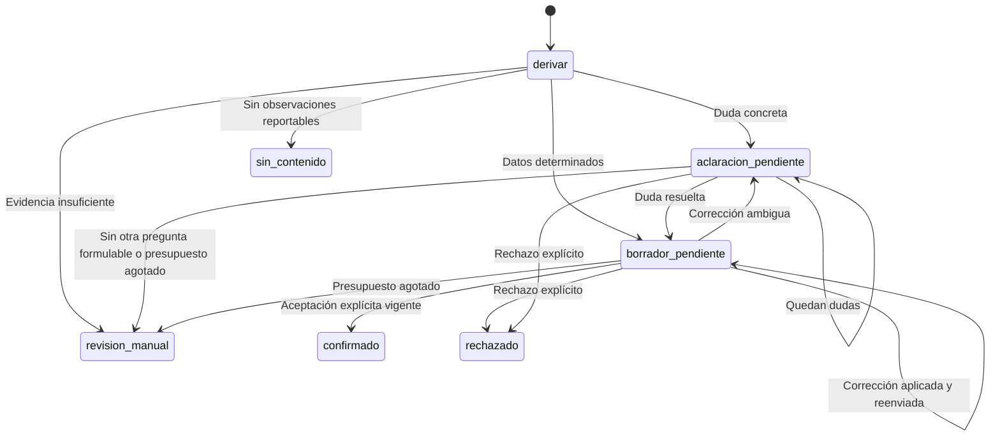

# Mini especificación · Parte de recorrida por voz

Diseño propuesto para A1–A4b del [Issue #11](https://github.com/eduardoTrigo/eduardo-trigo-Novit2026/issues/11), sobre `11-feat-voice-parts` y `b0d7f35`. La entrega de esta etapa es la especificación para revisión. La [evaluación anterior](EVALUACION_ENTREGA1.md) observó 13 notas sin borrador, seguridad B2 10/10, F1 2/2, F2 1/1 y ambas eliminatorias superadas.

El Issue #29 integra el runtime determinista de LangChain al worker del parte y mantiene la confirmación bajo control de SQLite. El presupuesto de 10 s activos comienza al seleccionar trabajo transcrito y se acumula entre turnos. Audio, STT y la espera del operador tienen sus propios ciclos. Las secciones históricas conservan el diseño del Issue #11. [Runtime, estados y verificación](SPEC_AGENT_RUNTIME.md)

## Requisitos y fuentes oficiales

El Enunciado TP, sección de parte por voz, y el Anexo Entrega 1, págs. 2–4, exigen STT local autorizado, una fila por equipo y variable, hora de la nota, asociación de fotos, extracción estructurada, aclaraciones justificadas y confirmación del operador. El parte debe funcionar durante el corte del enlace externo. El Anexo también pide un presupuesto de pasos y tokens, un timeout global por nota y persistencia de la conversación en PostgreSQL. SQLite guarda el estado operativo y PostgreSQL 16 proyecta la memoria por nota. La medición integral desde la emisión de la nota y la autorización oficial del modelo STT siguen pendientes. [Plan](PLAN.md) · [Arquitectura](ARQUITECTURA.md) · [Decisiones](DECISIONES_TECNICAS.md)

La copia vecina `../academia2026-tp` se inspeccionó en `ab65b95e911731351dba395817a74a8cc60da2b2`. Las referencias son `contrato/planta_contrato/__init__.py` (versión `0.2.0`), `docs/contrato.md`, `datos/planta.yaml`, `planta/sim/planta_sim/{app,operador,dialogo,simulador,ejemplo_sistema}.py`, `correccion/rubrica.yaml` y `correccion/puntuar.py`. Los PDF oficiales están en `L:\Novit2026`.

| Criterio | Qué mide el corrector |
| --- | --- |
| A1 | Nota con al menos un mensaje válido de tablet asociado que muestra filas. |
| A2 | Primer borrador confirmado por el operador virtual, sobre todas las notas evaluables. |
| A3 | Último borrador confirmado por el operador virtual, sobre todas las notas evaluables. |
| A4a | Nota marcada como ambigua con pregunta. El scorer reconoce un mensaje que espera respuesta y que carece de filas o presenta opciones. |
| A4b | Nota clara y sin condición insegura que recibió cero preguntas adicionales. Un borrador con filas y sin opciones puede pedir confirmación. |

`martes-tranquilo` y `fuga-sin-enlace` son los escenarios de Entrega 1. Las confirmaciones del corrector provienen del diálogo del simulador. La aceptación del agente debe verificar además la persistencia de su parte final. El comparador virtual considera las filas con valor numérico y compara principalmente equipo, valor y unidad. Variable, observaciones, hora y fotos requieren pruebas propias. El ejemplo oficial sirve para inspeccionar el intercambio de mensajes. Su lectura de `/api/verdad` queda excluida del runtime y ese endpoint se reserva para evaluación y desarrollo controlados.

### Interfaces verificadas

| Interfaz | Contrato y comportamiento |
| --- | --- |
| Entrada `planta/recorridas` | `NotaRecorrida(id, ts, operador, audio_url, fotos, recorrida_id)`. El audio es una URL relativa de WAV o `null`. `fotos` es una lista de URLs. |
| Salida `sistema/tablet` | `MensajeTablet(id, ts, nota_ids, texto, pantalla, audio_url, espera_respuesta)`. `Pantalla` admite `titulo`, `filas` y `opciones`. Cada `FilaParte` tiene `tag`, `variable`, `valor`, `unidad` y `observacion`. Los últimos tres admiten `null`. |
| Entrada `planta/respuestas` | `RespuestaOperador(id, ts, mensaje_id, operador, texto, audio_url)`. `mensaje_id` referencia `MensajeTablet.id`; `audio_url` admite `null`. El operador virtual contesta en 15–40 s simulados. Puede decir «Sí, confirmo», elegir por su nombre coloquial o devolver una corrección en texto libre. |
| `GET /api/planta` | Devuelve la definición que carga de `datos/planta.yaml`. Usar `equipos[].tag`, `tipo`, `nombres`, `manometro_local.unidad`, `sensores` y `lecturas_locales`. |
| `GET /api/historian/{tag}/{variable}?desde=&hasta=` | Devuelve registros con `ts` y `valor`. Retiene hasta 45 días a resolución de un minuto y puede devolver una lista vacía. La unidad proviene de la definición del sensor en `/api/planta`. |
| Medios locales | Resolver `NotaRecorrida.audio_url`, `NotaRecorrida.fotos` y, si se usa, `RespuestaOperador.audio_url` contra la API local `http://sim:8100` en Compose. El audio de salida de tablet puede quedar en `null` para que la planta lea su texto. |

Validar JSON de entrada con los modelos oficiales y construir cada salida con esos mismos modelos. El contrato usa `extra="forbid"`. Conservar hora y fotos en el parte interno, ya que `FilaParte` carece de esos campos. En el borrador usar `MensajeTablet.ts=nota.ts` y `nota_ids=[nota.id]`. Los IDs, estados y registros internos propuestos abajo pertenecen al agente. El protocolo público conserva los tópicos y campos verificados.

## Arquitectura propuesta

1. **Entrada y seguridad.** El [cliente MQTT](../src/sistema/mqtt_client.py) y [router](../src/sistema/nota_router.py) conservan el recorrido de la nota por [entrada persistente](../src/sistema/persistent_ingress.py), [almacén](../src/sistema/note_store.py) y [worker](../src/sistema/persistent_worker.py). [`analizar_nota`](../src/sistema/security_pipeline.py) ya descarga y transcribe una vez mediante [audio](../src/sistema/audio_service.py) y [Whisper](../src/sistema/whisper_adapter.py), y devuelve tanto el texto como los hallazgos. Ampliar el [procesador persistente](../src/sistema/security_persistent_processor.py) y su [transacción](../src/sistema/security_transaction.py) para guardar opcionalmente ese texto en `notas` al completar la nota y encolar las alertas existentes. Mantener el comportamiento de los llamadores actuales cuando omiten el texto. Una interrupción anterior al commit puede obligar a repetir la STT. Después del commit se reutiliza la transcripción duradera.
2. **Derivación de parte.** Un worker separado del circuito de seguridad toma transcripciones confirmadas en SQLite y respuestas persistidas. La cadena de LangChain valida los candidatos con Pydantic y aplica reglas locales deterministas para alias, unidades y diálogo. En el turno inicial descarga opcionalmente las fotos después de preparar y validar la salida de tablet. [Runtime del parte](SPEC_AGENT_RUNTIME.md)
3. **Salida y vuelta.** Guardar la versión del borrador, la transición y el mensaje de tablet en la misma transacción del parte, usando la misma [outbox SQLite](../src/sistema/security_outbox.py). Reutilizar su [worker](../src/sistema/outbox_worker.py) y [publicador QoS 1](../src/sistema/outbox_publisher.py) con acuse. Preservar el comportamiento actual de la outbox de seguridad, incluido el orden entre alerta y aviso. Cualquier cambio de prioridad requerirá evidencia que lo justifique. El heartbeat conserva su hilo, contrato y cadencia.
4. **Respuestas.** Agregar una suscripción a `Topicos.RESPUESTAS` con QoS 1 en cada conexión. Validar `RespuestaOperador` y persistir su payload en el callback, dejando la interpretación y las operaciones HTTP al worker. El texto es la fuente preferida. Si llega vacío y existe WAV, reutilizar descarga, validación y STT bajo el presupuesto del turno, serializando el acceso al motor y dando paso a seguridad antes de iniciar una transcripción de respuesta. Mantener la ruta actual de recorridas y probar reconexión para ambas suscripciones.

**Flujo de mensajes.** `planta/recorridas` → nota SQLite → audio y STT → seguridad y transcripción duradera → borrador o aclaración en `sistema/tablet` → respuesta en `planta/respuestas` → confirmación o nueva versión en `sistema/tablet`. Una alerta S1–S4 y su aviso conservan sus IDs y salen por el circuito de seguridad actual. El eventual consumo del parte confirmado por B1 corresponde a otro incremento funcional.

## Extracción y diálogo

- **Equipos.** Comparar tags y aliases de `equipos[].nombres` con límites de palabra y normalización de tildes y mayúsculas. Resolver por segmento, conservando contexto de equipo solo para referencias inequívocas del mismo segmento. «La dos» resuelve B-102, «el de la izquierda» F-201A y «la de reserva» B-103 en el catálogo verificado. Si «la bomba» puede señalar varios equipos, ofrecer los tags y alias candidatos. Las opciones son etiquetas de pantalla; la selección se interpreta por el texto de vuelta, no por un índice supuesto.
- **Lecturas.** Proponer filas únicas por `(tag, variable)` y conservar el texto de origen por candidato. Interpretar números hablados y formas como «uno ocho», «uno con ocho», `1,8` y `1.8` en contexto. Una repetición equivalente se consolida. Dos valores incompatibles para una misma fila requieren aclaración. Usar vocabulario contrastado con catálogo y generador oficial. El generador emite `presion_diferencial` para filtros aunque `lecturas_locales.filtros` lista `presion_diferencial_local`. Propuesta para este simulador: publicar `presion_diferencial` y tratar la variante local como alias de entrada. Las observaciones cualitativas pueden tener valor y unidad nulos. No inferir un caudal, cantidad de gotas o temperatura que el operador omitió.
- **Unidades.** Normalizar «kilos» a `kg/cm2`. Para presión de descarga local sin unidad explícita, tomar el manómetro de cada equipo: B-101 `kg/cm2`, B-102 `psi` y B-103 `bar`. Si la unidad explícita es clara, conservarla con su valor; cualquier conversión para comparar con el historian debe hacerse de manera explícita y dimensionalmente correcta. Preguntar si la unidad es dudosa o incompatible con la variable.
- **Rangos.** Proponer mínimo y máximo observados con muestras finitas y compatibles en la ventana de hasta 45 días anterior a `nota.ts`, conservando su offset en la consulta. Para la descarga local, consultar `presion_descarga` del mismo equipo y convertir para comparar. Para filtros, consultar `presion_diferencial`. Para lecturas que carecen de sensor equivalente, registrar la falta de rango. No usar límites de alarma como rango histórico ni un valor histórico como lectura. Un candidato claro fuera de rango necesita confirmación explícita. Un diferencial dicho como «dieciocho» puede significar `18` o `1,8`; pedir aclaración antes de confirmar.
- **Aclaraciones y correcciones.** Una nota clara va directo a un borrador con filas, `espera_respuesta=true` y sin opciones. Para duda de equipo, publicar opciones y dejar sin filas el mensaje de aclaración. Para duda numérica, probar una aclaración explícita con el candidato provisional y opciones cuando haya equipo y valor representables. Conservar los campos dudosos como pendientes hasta una respuesta inequívoca. El simulador elige un **equipo** cuando recibe opciones sin filas y compara el borrador cuando recibe filas numéricas. Un acuse genérico de una pregunta o una respuesta que solo identifica el equipo no resuelve una duda de valor. La aceptación explícita de una lectura puntual fuera de rango resuelve esa duda y habilita un borrador nuevo para confirmar. Una corrección se aplica únicamente a las filas o campos identificados, se revalida y se muestra en una nueva versión. «No» sin corrección suficiente deja el parte pendiente y consume un turno de aclaración. Un rechazo explícito cierra como rechazado. La confirmación final exige un borrador vigente sin dudas pendientes y una aceptación explícita, después de interpretar negaciones y correcciones.
- **Segmentación e incertidumbre.** Una mención genérica de equipo puede iniciar una cláusula aunque el STT haya omitido el artículo. Conservar por separado un rodamiento y una descarga del mismo equipo cuando la referencia es inequívoca. Si dos equipos comparten el sujeto de una medición, ofrecer las alternativas. Un sufijo desconocido como «pc y» da lugar a una duda de unidad. Los fragmentos reportables que quedan sin resolver conservan texto normalizado y motivo junto a la transcripción original. Los separadores mixtos de miles y decimal se aceptan si el agrupamiento es inequívoco.
- **Referencias a componentes.** «Hace ruido en el motor y el rodamiento» conserva ambos componentes dentro de la misma observación. Se separan las lecturas independientes con o sin artículo, incluidas «rodamiento 65 grados» y «el motor a 65 grados». Si la segunda lectura es incompleta, aproximada, negada o comparte una magnitud de alcance ambiguo, se conserva la primera fila sustentada y se registra el segmento para revisión. Si los límites entre las observaciones siguen siendo inciertos, se registra el fragmento completo. Una mención espacial de equipo por sí sola carece de evidencia para asignar el TAG.
- **Hora, observaciones y `VIVO-…`.** Los borradores conservan `nota.ts`. Una observación reportable con valor y unidad nulos admite confirmación humana. El operador virtual filtra las filas sin valor, por lo que un parte exclusivamente cualitativo puede quedar esperando su confirmación. Las notas `VIVO-…` se mantienen en revisión manual y conservan su evidencia.
- **Disponibilidad y corte.** Broker y API de planta siguen en `planta-lan` durante el corte externo. El rango histórico y los límites del catálogo se registran por separado. El historial truncado o con cobertura de ventana incompleta conserva cantidad y fechas de muestras y no aporta un rango concluyente. El turno usa 48 pasos, 10 s activos, reserva de cierre de 250 ms y un reintento compartido. La espera del operador se mide por separado y el parte admite tres interacciones.

### Fotografías

La cláusula puramente fotográfica queda fuera de la extracción de lecturas. En «Saqué foto de la tres, tiene las correas flojas», la segunda cláusula refiere a B-103 y conserva la observación. Si la lectura nombra otro equipo, se usa esa referencia. «Saqué foto de las correas de la tres» por sí sola conserva la referencia fotográfica.

El equipo y sus candidatos siguen vigentes dentro de la oración cuando una foto interrumpe la lectura. Un equipo nombrado en la nueva lectura tiene prioridad. Si una foto apunta a otro equipo y la lectura posterior carece de sujeto explícito, se conserva la duda. La exclusión de complementos espaciales se comparte con el análisis del objetivo fotográfico, incluso si la ubicación está entre comas.

La extracción y la asociación comparten los límites de la cláusula fotográfica. En «Saqué foto de la dos y el motor a 65 grados», la temperatura se atribuye a B-102 y la foto queda en la nota porque su variable no está identificada. Si la mención dice «foto de la empaquetadura de la dos», esa evidencia puede asociar la foto al goteo de B-102 aunque la cláusula siguiente mencione otra variable o equipo.

La extracción y la asociación detectan las menciones con el mismo recorrido de la transcripción. Una única foto adjunta requiere una única mención singular y afirmativa con equipo y variable explícitos para asociarse o crear un objetivo pendiente. Se consideran las menciones posteriores aun si están en la misma oración, repiten el objetivo o dejan el complemento incompleto. El plural y las referencias elípticas como «y otra» después de una mención aportan evidencia de que puede haber varias fotos. En esos casos el adjunto queda a nivel de nota sin objetivo pendiente. Una mención negada o dudosa tampoco aporta contexto de equipo a una lectura posterior.

Cada referencia registra un identificador derivado de la nota y la ruta, timestamp, estado de descarga, procedencia y motivo. Si una mención inequívoca identifica un único `(tag, variable)` que todavía falta, se guarda como `objetivo_pendiente` junto con el fragmento original. Tras una aclaración, LangChain compara ese objetivo con las filas validadas dentro del presupuesto del turno. Si coincide, el worker guarda la asociación en la misma transacción que las filas y el borrador. Los turnos posteriores reutilizan los metadatos y el binario ya persistidos.

Una referencia ambigua o varias rutas sin correspondencia individual quedan en la nota. Una corrección de valor conserva el vínculo y un cambio de identidad lo invalida. Una asociación invalidada conserva ese estado aunque el TAG original vuelva a aparecer. Las versiones anteriores conservan su contexto. Si falta presupuesto para reconsiderar la foto, el objetivo sigue pendiente. Los registros anteriores que carecen del objetivo opcional siguen siendo legibles y conservan su estado.

Los complementos de lugar se excluyen al identificar el objetivo fotográfico. «Foto de un goteo cerca de la dos» queda en la nota y carece de objetivo pendiente. «Foto del goteo de la dos junto a la tres» permite vincular la fila de B-102 porque el vínculo directo está explícito. Cuando la frase deja incierto qué equipos son objetivos y cuáles describen la ubicación, la foto queda en la nota.

El descargador comparte las validaciones de B1. Para partes admite las rutas relativas `/media/fotos/…` del simulador local, con prefijo y terminador JPEG o PNG y verificación de longitud cuando está declarada. El worker admite tres descargas por nota, 512 KiB por archivo y 750 ms por intento. Usa un carril aislado y omite la descarga cuando falta presupuesto. Un 404, un timeout o un formato inválido conserva la ruta y deja que el parte continúe.

## Estados, persistencia y recuperación

Los estados de conversación son internos. `notas.estado` sigue representando la ejecución del worker de seguridad. Los estados terminales del parte son `confirmado`, `rechazado` y `sin_contenido`. `revision_manual` conserva evidencia para resolución humana posterior.

Una duda formulable entra en `aclaracion_pendiente` junto con su mensaje correlacionable en outbox. Si queda contenido sin interpretar y el worker carece de una pregunta concreta, el parte pasa a `revision_manual` y conserva la transcripción, las filas sustentadas y el historial de respuestas. Al reabrir SQLite, los partes anteriores que quedaron esperando sin mensaje o sin una duda vigente pasan a revisión manual.

| Registro SQLite | Identidad y datos |
| --- | --- |
| Transcripción en `notas` | Columna nullable. Mantiene el payload original y el circuito de seguridad. El worker de partes deriva tareas a partir de transcripciones duraderas. Las notas históricas sin texto se conservan sin reproceso automático. Una entrada `VIVO-…` válida con fotos y sin audio se registra para revisión manual y queda fuera del reclamo del worker de seguridad. |
| Parte y versiones | `nota_id` único, estado, versión activa, intento, hora de nota, referencias de fotos y evidencia de resolución. Cada revisión conserva las filas validadas, dudas, asociaciones y la respuesta que la originó. Solo la versión aceptada se marca como final. |
| `fotos_partes_blob` | Contenido JPEG o PNG por SHA-256, con un máximo agregado de 64 MiB de binarios. Se crea de forma aditiva e idempotente y se escribe en la misma transacción que el parte y su outbox. |
| Mensajes de conversación | Relación duradera `MensajeTablet.id` → nota, versión, tipo de turno e identificador de outbox. ID propuesto `PARTE-{nota_id}-{secuencia}` estable para una misma publicación, con secuencia nueva cuando cambia el contenido. |
| Bandeja de respuestas | `RespuestaOperador.id` único, payload original, resultado y estado de aplicación. Dedupe adicional por mensaje y contenido normalizado para reenvíos con ID nuevo. Un mensaje vencido o de una versión anterior queda registrado y no modifica el parte activo. |

Cada transición compara el estado y la versión vigente y guarda la aplicación de la respuesta y el siguiente mensaje de outbox en un único commit. Una respuesta duplicada o desfasada no crea versiones ni publicaciones nuevas. Si el broker repite un envío por falta de acuse, el mensaje de tablet conserva su ID y su payload; el simulador deduplica por ese ID. Si el proceso cae, recuperar las tareas reclamadas y no aplicadas de la bandeja, revisar borradores pendientes y reanudar la outbox con sus IDs originales. Un turno ya publicado permanece correlacionable tras reiniciar y no genera un mensaje nuevo por el solo reinicio. Correlaciones desconocidas se registran y quedan fuera de la mutación del parte. Los callbacks y la base local no garantizan recuperar mensajes que el broker no entregó durante una desconexión.

SQLite conserva la identidad, las versiones, la recuperación de respuestas y la atomicidad con la outbox. La cola de memoria proyecta las referencias y asociaciones de cada versión en PostgreSQL. El respaldo de SQLite, tomado con su API de respaldo o con el agente detenido, incluye el registro de fotos. Para recuperar una evidencia se abre la copia aislada, se obtiene el SHA-256 del contexto y se consulta `fotos_partes_blob` o `AlmacenPartes.obtener_foto`. La política de retención de memoria conserva su seguimiento separado. [Memoria conversacional](SPEC_MEMORIA_CONVERSACIONAL.md)

## TDD e incrementos

Los archivos nuevos de esta lista son propuestos. Las rutas enlazadas existen.

| Incremento | Primeras pruebas y evidencia esperada | Archivos |
| --- | --- | --- |
| 1 · Entrega duradera de la transcripción y regresión de seguridad | Un WAV se baja y transcribe una vez en el flujo normal. Tras el commit, el parte puede consultar el texto guardado. Probar S1–S4, misma pareja alerta/aviso, rollback, datos previos sin texto y conservación del comportamiento de outbox. | Reutilizar [pipeline](../tests/test_security_pipeline.py), [procesador](../tests/test_security_persistent_processor.py), [detector](../tests/test_security_detector.py), [transacción](../tests/test_security_transaction.py), [worker](../tests/test_persistent_worker.py), [migración](../tests/test_note_store_retries.py), [outbox](../tests/test_outbox_worker.py) y [publicador](../tests/test_outbox_publisher.py). |
| 2 · Extracción y borrador claro | «La dos está en 1640 de descarga» produce `B-102/presion_descarga_local/1640/psi` y un borrador sin opciones. Una nota con dos bombas y un filtro produce filas únicas sin cruzar valores. Probar aliases, unidades B-101/B-102/B-103, «kilos», decimales y observaciones sin valor. Validar fechas, fotos por fila, conservación de fotos no atribuibles y `VIVO-…` sin medidas. | Crear `tests/test_part_extraction.py` y `tests/test_part_messages.py`. Reutilizar [contrato](../tests/test_contrato.py), [HTTP](../tests/test_audio_service.py), [router](../tests/test_nota_router.py) y [STT](../tests/test_transcription_service.py). |
| 3 · Conversación e idempotencia | Confirmación explícita del primer borrador. «No, la uno estaba en ciento quince kilos» actualiza solo la fila correspondiente, publica una versión y exige su confirmación. Probar rechazo, mensaje desconocido, respuesta previa, duplicados y reinicio con una respuesta recibida o borrador pendiente. Verificar reconexión a los dos tópicos, ausencia de trabajo pesado en callback y heartbeat sin regresión. | Crear `tests/test_part_workflow.py` y `tests/test_part_store.py`. Ampliar [MQTT](../tests/test_mqtt_client.py) y reutilizar [reintentos de outbox](../tests/test_security_outbox_retries.py). |
| 4 · Ambigüedad, histórico y operación local | «La bomba» ofrece opciones oficiales. Un alias único no pregunta de más. «Dieciocho» de diferencial mantiene el valor pendiente hasta aclaración. Probar fuera de rango, conversión, historial vacío, timeout HTTP, corte externo con servicios locales disponibles y presupuesto agotado. Cubrir las diferencias entre pregunta con opciones, borrador claro y corrección numérica del operador virtual. | Ampliar `tests/test_part_extraction.py` y `tests/test_part_workflow.py`. Agregar fixtures del formato oficial y un recorrido completo con dobles de MQTT, HTTP y STT y una SQLite temporal. |

## Archivos de implementación previstos

- Modificar [`security_integrated.py`](../src/sistema/security_integrated.py), [`mqtt_client.py`](../src/sistema/mqtt_client.py), [`nota_router.py`](../src/sistema/nota_router.py), [`note_store.py`](../src/sistema/note_store.py), [`security_persistent_processor.py`](../src/sistema/security_persistent_processor.py) y [`security_transaction.py`](../src/sistema/security_transaction.py) para cableado, ruteo y entrega de texto persistente.
- Reutilizar [`security_outbox.py`](../src/sistema/security_outbox.py) con el comportamiento vigente. Extender [`audio_service.py`](../src/sistema/audio_service.py) solo si conviene extraer el GET local acotado para medios. Reutilizar `security_pipeline.py`, `persistent_worker.py`, `whisper_adapter.py`, `security_messages.py`, `outbox_worker.py` y `outbox_publisher.py` como base.
- Crear módulos del parte según los incrementos: `src/sistema/part_extraction.py`, `part_workflow.py`, `part_store.py` y `part_context.py`, todos bajo `src/sistema/`. Mantener los adaptadores junto a su primer uso y validar las rutas y contratos antes de ampliar el alcance.

## Comportamiento implementado en el Incremento 4

- Una selección de equipo muestra tags y alias del catálogo sin filas numéricas. Si la nota tampoco identifica la variable, una segunda aclaración pregunta qué se midió. El operador virtual puede elegir el equipo. La variable ausente puede requerir intervención humana.
- Para un diferencial de «dieciocho», la tablet pregunta «18 o 1,8». Con tag y unidad conocidos, muestra una fila provisional y pide confirmar solo si la lectura era 18 en esa unidad. El turno persistido autoriza aceptar una confirmación inequívoca de ese candidato. Con datos suficientes, el worker publica el borrador para confirmación. Una aceptación genérica sin candidato vinculado o una respuesta insuficiente conserva el turno pendiente sin reenviarlo. El operador virtual interpreta las opciones sin filas como selección de equipo y deja sin resolver preguntas numéricas de texto libre.
- El worker compara lecturas compatibles con al menos dos muestras válidas en fechas distintas durante los 45 días anteriores a la nota. Conserva la zona horaria de la nota, los valores y unidades originales, las unidades de comparación y la evidencia de histórico y límites de alarma por separado. Con historial vacío, insuficiente o inaccesible, usa las verificaciones disponibles y publica el borrador directo si la lectura es clara. Por consulta usa un timeout HTTP de dos segundos y reintenta una vez ante errores de red o timeout.
- SQLite conserva el turno, las dudas, las resoluciones y un contador independiente de la versión. Cada respuesta distinta aplicada al turno vigente consume una interacción, incluso si el texto es insuficiente. La tercera puede confirmar o rechazar el parte. Si todavía se necesita una respuesta, el parte pasa a revisión manual. Los duplicados, las respuestas desfasadas y los reintentos técnicos de STT quedan fuera del contador. El contador, el resultado, el estado y la publicación siguiente se guardan en una transacción.
- El worker retoma las respuestas `requiere_stt` desde SQLite y guarda la transcripción antes de aplicar la respuesta. La descarga se ejecuta fuera de MQTT, con un plazo de 2 s y un límite de tamaño. Seguridad tiene prioridad cuando hay una nota en curso o lista para procesar. Tablet comparte el motor local y admite WAV de hasta 5 s, con generación de hasta 48 tokens y un plazo cooperativo de 5 s. Los errores transitorios tienen un máximo de tres intentos. Un audio inválido o un agotamiento deriva a revisión manual si el turno sigue vigente. Una inferencia nativa de tablet en curso puede demorar una nota de seguridad recién llegada hasta que esa inferencia ceda el motor. Falta medir esa latencia con audio real.
- En lecturas numéricas, «menos» se acepta como signo cuando acompaña inequívocamente a la magnitud. Las negaciones, comparaciones y signos contradictorios quedan pendientes.

## Validación integrada del Issue #11

- La suite previa a la corrección del estado de aclaración aprobó 183 pruebas. La prueba de integración cubrió ingreso y respuesta MQTT, descarga WAV y STT con dobles, publicaciones de seguridad y del parte, y confirmación tras reabrir SQLite.
- La comprobación directa con la función oficial del operador virtual aceptó un candidato numérico explícito, corrigió valores, unidades y equipos, y dejó pendiente la pregunta numérica en texto libre. Esta comprobación usó datos sintéticos.
- El corrector oficial obtuvo 67,3/100 en `martes-tranquilo` y `fuga-sin-enlace` antes de la última corrección del estado de aclaración. [Resultados oficiales y rutas de evidencia](EVALUACION_ISSUE11.md)
- Tras la corrección, la suite reportó 187 pruebas aprobadas y 0 fallidas. Cubrió la derivación a revisión manual del contenido sin interpretar que carece de una pregunta concreta, la conservación de lecturas parciales y la recuperación al reabrir SQLite. La versión corregida aún no fue reevaluada con el corrector oficial.
- Tras las correcciones de la revisión del PR #12, pytest reportó 204 pruebas aprobadas y 0 fallidas. La reevaluación oficial sigue pendiente. El puntaje de 67,3/100 corresponde a la corrida anterior documentada.

## Riesgos y revisión humana

- Ampliar los escenarios oficiales para conversaciones de varias lecturas. Revisar la aclaración adicional de `NOTA-00006` en `martes-tranquilo` y medir el commit final para completar el presupuesto inicial de 10 s.
- Confirmar autorización de `faster-whisper base` y arranque sin Internet. Medir si la carga SQLite, el uso de CPU y el comportamiento actual de la outbox mantienen el margen observado en B2 y F2 antes de proponer cambios de prioridad.
- Obtener revisión humana antes de implementar o migrar tablas. La incorporación de un modelo nuevo, dependencias o infraestructura y una próxima corrida oficial requieren autorización específica.

## Memoria conversacional en el Issue #17

Las transiciones del parte siguen en SQLite. Cada cambio confirmado de nota, parte o respuesta registra una revisión para publicar su captura histórica en PostgreSQL. El estado de los turnos y los borradores sigue disponible durante una caída de PostgreSQL. Los intentos técnicos de audio se proyectan por separado del contador de interacciones. [Mini spec y política de memoria](SPEC_MEMORIA_CONVERSACIONAL.md)
